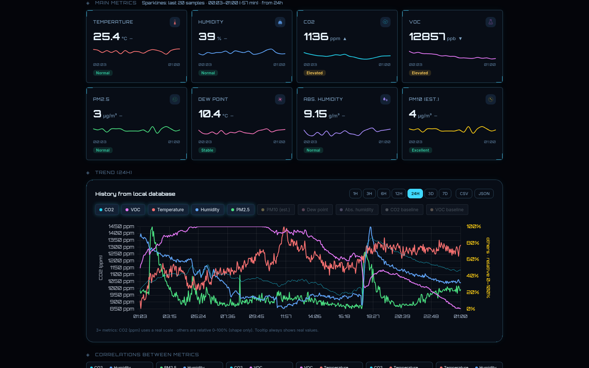

# Awair Monitor Dashboard

Indoor conditions are easier to understand when the latest readings can be compared with what happened earlier. Awair Monitor Dashboard brings Awair Element measurements, trends and history into one workspace, helping users notice changes in a room without repeatedly switching between device readings and separate reports.

## Tech stack

| Layer | Technologies |
|---|---|
| Core stack | Python; Svelte; JavaScript; SQLite |

## See the room at a glance

A current-condition overview and measurement cards put the important readings together. Temperature, humidity and air-quality measurements can be checked in context rather than as isolated numbers. Selecting a sensor keeps the view useful when more than one device is being monitored.

The current view is useful for a quick room check. When a reading deserves attention, the selected device and surrounding measurements provide a clear route into the historical views.

## Compare changes over time

Trend charts and score history help show whether a change was brief or part of a longer pattern. Choose the period relevant to the question and compare readings from that window. This is useful for reviewing how a room changed during the day or after a change in its use.

Compare the same period across relevant measurements when reviewing a change in a room. A short excursion and a sustained pattern can then be examined within the same selected window.

## Explore daily patterns

Daily summaries, trends and comparison views provide more context than the latest sample alone. Correlation information offers another way to explore which measurements move together. It supports investigation without proving a cause for the change.

Daily summaries offer a starting point for repeated review, while the detailed charts support a more specific question. Move between the two rather than relying on one remembered reading.

## Keep and share useful results

CSV and JSON export options let users retain observations for their own review. The dashboard's history makes it possible to return to an earlier period rather than relying on a remembered reading. Device and connection information help identify when a view may need attention.

Exports are useful when a period should be kept for a separate analysis or discussion. Device and connection context help establish which observations support that result.

## Make the dashboard comfortable

Aurora and Nexus presentations provide different visual styles. Language and display preferences support the established English and Slovak interface, while settings and logs give the operator a place to maintain the installation. The result is one familiar view for checking conditions and reviewing their history.

The presentation can fit a brief check or a dashboard kept open during the day. Existing language preferences remain available without changing the meaning of the measurements.

---

Private code: [le-awair-monitor-dashboard](https://github.com/logicencoder/le-awair-monitor-dashboard)

See [REPOS.md](REPOS.md) for related repositories.

**[Logic Encoder](https://logicencoder.com)** · [GitHub](https://github.com/logicencoder) · [Contact](https://logicencoder.com/contact/)
