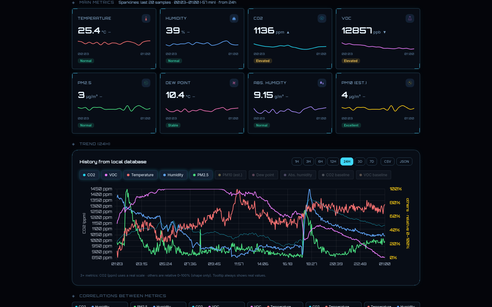

# Awair Monitor Dashboard

Indoor conditions are easier to understand when the latest readings can be compared with what happened earlier. Awair Monitor Dashboard brings Awair Element measurements, trends and history into one workspace, helping users notice changes in a room without repeatedly switching between device readings and separate reports.

## Tech stack

| Layer | Technologies |
|---|---|
| Core stack | Python; Svelte; JavaScript; SQLite |

## See the room at a glance

The front page shows a score gauge and one card per measurement (temperature, humidity and the air-quality values the device reports), read live from the Awair Element's local interface. Several sensors can be added, edited and removed, and selecting one switches the whole view to that device; its details are shown beside the readings.

The current view is useful for a quick room check. When a reading deserves attention, the selected device and surrounding measurements provide a clear route into the historical views.

## Compare changes over time

Trend charts and the score history show whether a change was brief or part of a longer pattern. A range toggle chooses the period (one hour up to seven days), and the same period applies to every chart, so a short excursion and a sustained change can be read in one window.

Compare the same period across relevant measurements when reviewing a change in a room. A short excursion and a sustained pattern can then be examined within the same selected window.

## Explore daily patterns

The Daily, Trends and Correlations views summarise each day, show how measurements moved and rank which ones move together, and Uptime shows how reliably the device reported. Correlation points at measurements that change together and does not prove a cause.

Daily summaries offer a starting point for repeated review, while the detailed charts support a more specific question. Move between the two rather than relying on one remembered reading.

## Keep and share useful results

A period of readings can be exported as CSV or JSON for separate analysis. The history is kept in a local SQLite database, so an earlier period can always be revisited.

Exports are useful when a period should be kept for a separate analysis or discussion. Device and connection context help establish which observations support that result.

## Make the dashboard comfortable

Two visual styles, Aurora and Nexus, and an English and Slovak interface are available. In Settings the operator can configure notifications through a webhook or an ntfy address, send a test message and snooze alerts for a while; a Logs page shows what the collector has been doing.

The presentation can fit a brief check or a dashboard kept open during the day. Existing language preferences remain available without changing the meaning of the measurements.

---

Private code: [le-awair-monitor-dashboard](https://github.com/logicencoder/le-awair-monitor-dashboard)

See [REPOS.md](REPOS.md) for related repositories.

**[Logic Encoder](https://logicencoder.com)** · [GitHub](https://github.com/logicencoder) · [Contact](https://logicencoder.com/contact/)
