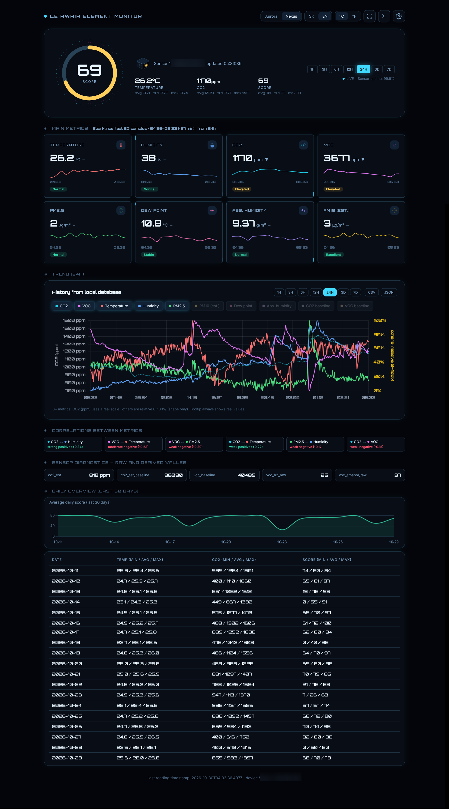
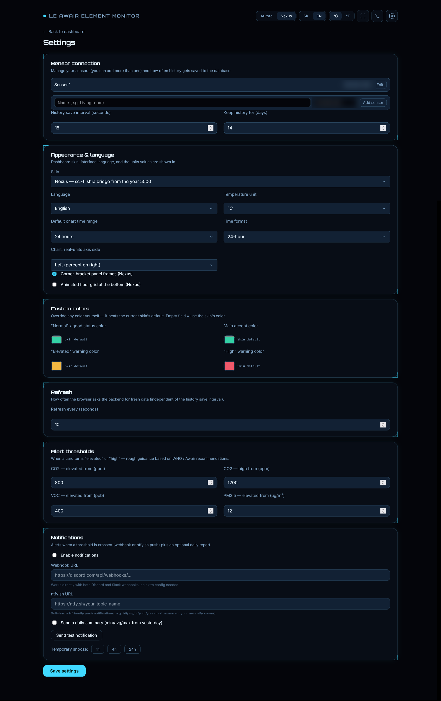

# Awair Monitor Dashboard

A room's air changes all day, but the Awair Element only shows its current reading, and the manufacturer's route to its history runs through a cloud service. Awair Monitor Dashboard is a browser dashboard that reads the Element directly, stores every reading and puts the score, eight measurements, trends, daily summaries and alerts in one place.

It grew out of a gap: nothing like it existed, and the device turned out to have a local API. So the dashboard talks to the sensor on the home network instead of going through the cloud.

You can watch a room live, look back over a period of up to seven days, compare measurements that move together, export a period as a file and be notified when a value crosses your own thresholds. Several sensors can be monitored from one dashboard.

## Tech stack

| Layer | Technologies |
|---|---|
| Backend | Python, FastAPI, uvicorn |
| Interface | Svelte 5, SvelteKit, Vite |
| Charts | Chart.js |
| Data | SQLite history and daily statistics |
| Live updates | Background sensor polling, browser refresh on a timer |
| Integrations | Awair Element local API, webhook (Discord and Slack), ntfy |
| Platform | Browser, installable as a standalone web app |

## Check the room at a glance

The **Score** gauge at the top of the page is a ring from 0 to 100 that takes the "normal" colour at 80 or above, the "elevated" colour from 60 and the "high" colour below that. Beside it sit the sensor name, the time of the last update and a **LIVE** tag that blinks while data is flowing; if the sensor cannot be reached, the tag changes to "last available reading (sensor offline)" and the last stored values are shown instead.

Three headline figures follow: **Temperature**, **CO2** in ppm and **Score**, each with average, minimum and maximum for the selected period. A **Sensor uptime** percentage shows how many polling attempts succeeded over the last seven days. The range buttons **1H, 3H, 6H, 12H, 24H, 3D** and **7D** set the period for the whole page, and the keys 1 to 7 do the same.

The value is a first answer in one glance: is the room fine now, and has the sensor been reporting reliably?

<!-- TODO(screenshots, 2026-11-21): Score gauge, headline figures and range buttons -->

## Read every measurement on its own card

The **Main metrics** section shows one card per measurement, in this default order: Temperature, Humidity, CO2, VOC, PM2.5, Dew point, Abs. humidity and PM10 (est.), in °C, %, ppm, ppb and µg/m³ or g/m³ as appropriate. Each card has a small sparkline of the last 20 samples of the selected period, with a line above the cards stating the sample count and time span.

CO2 shows a **Normal**, **Elevated** or **High** tag, and VOC and PM2.5 show Normal or Elevated, judged against the thresholds from Settings. A trend arrow marks a value as rising, falling or stable over the last 30 minutes, and the rising arrow turns amber when the value is on course to reach its elevated threshold within six hours. Drag the cards to reorder them; the order is saved.

The value is early warning: a card tells you not only where a reading is but which way it is heading.

<!-- TODO(screenshots, 2026-11-21): Main metrics cards with sparklines and trend arrows -->

## Compare measurements and export a period

The **Trend** chart, titled **History from local database**, plots stored readings for the selected period. Chips above the chart switch each series on or off; CO2 and VOC are plotted by default, and the other series include temperature, humidity, PM2.5, PM10 (est.), dew point, absolute humidity and the CO2 and VOC baselines.

Two series with different units get two real axes. With three or more, the first keeps a real scale and the others are drawn relative from 0 to 100 percent to show their shape, while the tooltip always shows real values. A setting chooses whether the real-units axis sits on the left or the right. Long periods are averaged into about 480 points so a seven-day chart stays readable.

Two buttons in the chart header, **CSV** and **JSON**, download the readings for the selected period and sensor, so a period from 1 hour to 7 days can be opened in a spreadsheet or another tool without querying the database.

The value is context and portability: you can see whether a CO2 peak coincided with a temperature or humidity change, and keep the numbers.

<!-- TODO(screenshots, 2026-11-21): Trend chart with metric chips and dual axes -->

## Find measurements that move together

The **Correlations between metrics** section ranks pairs among CO2, VOC, PM2.5, Temperature and Humidity by how strongly they move together over the selected period. Each chip shows the pair, a label of strong (0.7 and above), moderate (0.5 and above) or weak, a positive or negative direction and the coefficient. The six strongest pairs are shown, and a pair needs at least ten readings to appear; until then the section says there is not enough data yet.

A correlation shows that two values change together, not that one causes the other. The value is a shortcut to the question "what changes when CO2 climbs?".

<!-- TODO(screenshots, 2026-11-21): Correlations chips -->

## Inspect raw sensor values

The **Sensor diagnostics — raw and derived values** section lists five internal readings from the device as plain rows: co2_est in ppm, co2_est_baseline, voc_baseline, voc_h2_raw and voc_ethanol_raw. A row shows -- when the sensor has not reported that value. The baselines are also available as chart series in the Trend chart, and they refresh on the same timer as the rest of the page.

The value is transparency: when a derived card looks odd, the underlying numbers are one scroll away.

## Review each day

The **Daily overview (last 30 days)** section opens with a line chart, **Average daily score (last 30 days)**, followed by a table with Date, Temp, CO2 and Score columns, each showing minimum, average and maximum for the day. Hovering a row also shows the VOC and PM2.5 minimum, average and maximum. Temperature follows the chosen unit.

Until enough history exists, the section shows a message to check back tomorrow. The value is a long view: a bad afternoon can be compared with the days around it.

<!-- TODO(screenshots, 2026-11-21): Daily overview chart and table -->

## Switch look, language and units from the top bar

Quick toggles in the top bar change the skin (**Aurora** or **Nexus**), the language (**SK** or **EN**) and the temperature unit (**°C** or **°F**) without opening Settings. With more than one sensor, a dropdown switches the whole page to another device.

The **kiosk** button (or the K key) goes fullscreen for a wall display, and Esc leaves it. Pressing ? lists the keyboard shortcuts. Nexus presents the same data as a ship-bridge interface with a drawn sensor, orbital rings on the gauge and optional corner frames and floor grid.

The value is a dashboard that fits a quick check on a laptop or a screen left on all day.

<!-- TODO(screenshots, 2026-11-21): Nexus skin and kiosk mode -->

## Tune everything in Settings

**Settings** is split into panels. **Sensor connection** adds, edits and removes sensors by name (1 to 100 characters) and address, always keeping at least one, and sets the **History save interval** (default 15 seconds, 5 to 3600) and **Keep history for** days (default 14, up to 3650). **Appearance & language** sets the skin, language, temperature unit, **Default chart time range** (default 24 hours), a 24-hour or AM/PM clock, the chart axis side and the Nexus effects. **Custom colors** overrides the accent and the "normal", "elevated" and "high" colours; an empty field uses the skin's colour. **Refresh** sets how often the browser asks for fresh data (default every 10 seconds, minimum 3).

The value is that one place controls how the dashboard collects, stores and presents data.

## Get alerted when air quality crosses your limits

**Alert thresholds** set when a card turns elevated or high: CO2 elevated from 800 ppm and high from 1200 ppm, VOC elevated from 400 ppb and PM2.5 elevated from 12 µg/m³, all editable. The CO2 high limit must stay above the elevated limit. The values are rough guidance; for health questions refer to the [WHO air quality guidelines](https://www.who.int/publications/i/item/9789240034228) and the device maker's recommendations.

Under **Notifications**, turn on **Enable notifications**, then enter a **Webhook URL** (works with Discord and Slack) and an **ntfy.sh URL**. A message goes out when a level changes, including when it returns to normal, and repeats every 30 minutes while a value stays elevated or high. **Send test notification** checks the setup, **Temporary snooze** pauses alerts for 1h, 4h or 24h, and an optional daily summary sends yesterday's minimum, average and maximum CO2 and VOC with the average score.

The value is that you do not have to watch the page: the alert reaches your phone or chat.

<!-- TODO(screenshots, 2026-11-21): Alert thresholds and Notifications panel -->

## Check the connection history

The **Connection logs** page, opened from the top bar, lists the last 200 attempts to reach the sensor with **Time**, **Status** (OK or Failed) and **Detail**, which holds the error message of a failed attempt. It reloads every five seconds, and attempts are kept for 90 days.

The value is a quick diagnosis when a gap appears in the charts or uptime drops.

<!-- TODO(screenshots, 2026-11-21): Connection logs -->

## Scope and limits

Readings come from the Awair Element's own local interface, so the dashboard works while the browser can reach the device and the history covers only the time the dashboard has been collecting. History older than the retention setting is deleted. PM10 is an estimate, labelled as such, and the tags, trends and correlations are indicators, not diagnoses. The dashboard offers no personal or medical advice; for health guidance use the official WHO source linked above.

## Understand your room's air without the cloud

The monitoring journey runs from the gauge and cards to the trend chart and correlations, and ends with the daily overview. Each step uses the same period, sensor and units, so a reading can be traced from the first glance to its history.

The control journey runs through Settings: thresholds, notifications, the connection log and exports. They keep the dashboard informing you and your own analysis supplied, with the data staying with you.

---

Private code: [le-awair-monitor-dashboard](https://github.com/logicencoder/le-awair-monitor-dashboard)

See [REPOS.md](REPOS.md) for related repositories.

**[Logic Encoder](https://logicencoder.com)** · [GitHub](https://github.com/logicencoder) · [Contact](https://logicencoder.com/contact/)
